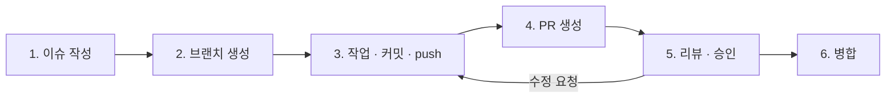

# 협업 규칙

이슈 작성부터 병합까지 모든 작업은 아래 6단계를 거쳐요. **각 단계의 실행(이슈 생성, 브랜치 생성, 커밋, push, PR 생성, 승인, 병합)은 사람이 직접 해요.** AI는 내용(이슈 본문, 코드, 커밋 메시지, PR 본문, 리뷰 의견)의 초안만 써요. AI 사용 방법은 [ai-guidelines.md](ai-guidelines.md)에 있어요.

해커톤이라 일정이 짧아요. 규칙은 **추적(이슈 ↔ 브랜치 ↔ PR)과 리뷰 1명**만 지키도록 가볍게 잡았어요.

## 한눈에 보기



| 단계 | 하는 사람 | AI가 도울 수 있는 것 |
| --- | --- | --- |
| 1. 이슈 작성 | 작업자 | 이슈 템플릿에 맞춘 본문 초안 |
| 2. 브랜치 생성 | 작업자 | 규칙에 맞는 브랜치 이름 제안 |
| 3. 작업 · 커밋 · push | 작업자 | 코드 작성, 커밋 메시지 초안. **커밋과 push는 사람이** |
| 4. PR 생성 | 작업자 | PR 제목 · 본문 초안 |
| 5. 리뷰 · 승인 | 리뷰 짝 1명 이상 | 리뷰어가 diff를 이해하는 데 참고. **의견 작성과 승인은 리뷰어가** |
| 6. 병합 | 작업자 (승인 후) | 없음 |

## 처음 한 번 할 일

```bash
git clone https://github.com/livelykitten/retail_convinient_store_lgcns6.git
cd retail_convinient_store_lgcns6/backend
./gradlew bootRun        # Windows는 gradlew.bat bootRun
```

- 카카오 · AI 키는 환경 변수로 넣어요. 값은 팀 채널에서 받고, 저장소에는 올리지 않아요. 변수 이름은 [design.md](design.md#5-외부-api)에 있어요.
- 백엔드 코드는 모두 `backend/` 안에 있어요. Gradle 명령은 `backend/`에서 실행해요.

## 1. 이슈 작성

작업을 시작하기 전에 이슈부터 만들고 Projects 칸반에 올려요. **이슈가 없는 PR은 받지 않아요.**

| 템플릿 | 언제 |
| --- | --- |
| 작업 | FR 구현, 설정 작업 |
| 버그 | 동작이 잘못됐을 때 |
| 스펙 변경 | API 요청 · 응답, 테이블, 모듈 간 인터페이스, 오류 형식을 바꿀 때 |

- **제목**: `[FR-xx] 할 일` 또는 `[모듈] 할 일`. 예) `[FR-04] 4단계 결제액 계산`, `[common] 공통 오류 응답`
- **담당자(Assignee)**: 작업할 사람 1명. 카드 1장 = 작업 1개, 담당 1명
- **라벨**: 모듈 라벨 1개 이상 + 타입 라벨 1개
- **크기**: 한 스프린트 안에 PR까지 갈 수 있는 크기로 나눠요. 넘으면 이슈를 쪼개요.
- **완료 기준**: 리뷰어가 확인할 수 있는 결과로 적어요. "구현 완료"처럼 쓰지 않아요. 요구사항명세서의 수용 기준을 옮겨 적어도 돼요.

### 칸반 (GitHub Projects)

| 열 | 언제 옮기나 |
| --- | --- |
| 할 일 | 이슈를 만들었을 때 |
| 진행 중 | 브랜치를 만들고 작업을 시작할 때 |
| 리뷰 | PR을 열었을 때 |
| 완료 | PR이 병합됐을 때 (이슈가 닫히면 자동) |

### 스펙 변경 이슈

다른 담당자의 코드나 프런트에 영향을 주는 변경이에요. 아래 순서를 지켜요.

1. PM2(민경완)에게 먼저 말하고, 요구사항명세서를 고쳐요.
2. 스펙 변경 이슈를 열고, 영향받는 사람(백엔드 · 프런트)을 모두 체크해요.
3. 영향받는 사람이 이슈에 확인 댓글을 달아요.
4. `docs/`(design.md, reference/)를 고치는 PR(`docs` 타입)을 먼저 병합해요. 급하면 코드 PR에 함께 넣되, 리뷰어에 영향받는 사람을 모두 넣어요.
5. 그다음에 코드를 고쳐요.

## 2. 브랜치 생성

```bash
git switch main
git pull origin main
git switch -c feat/FR-04-quote-calc
```

### 이름 규칙

```
<타입>/<FR번호 또는 이슈번호>-<짧은-설명>
```

| 예 | 뜻 |
| --- | --- |
| `feat/FR-04-quote-calc` | FR-04 결제액 계산 |
| `feat/FR-03-kakao-stores` | FR-03 카카오 매장 조회 |
| `fix/FR-10-stock-hash` | FR-10 재고 해시 버그 |
| `chore/7-h2-setup` | 7번 이슈, H2 설정 |
| `docs/12-erd` | 12번 이슈, ERD 문서 |

- 타입은 커밋 타입과 같아요.
- FR이 없는 작업(공통 설정, 문서)은 이슈 번호를 써요.
- 설명은 영어 소문자, 숫자, `-`만 써요.
- 이슈 하나에 브랜치 하나예요.

### 브랜치 종류

| 브랜치 | 용도 |
| --- | --- |
| `main` | 통합 · 시연. 모든 작업 브랜치의 대상. **직접 push하지 않아요** |
| `<타입>/*` | 작업 |

## 3. 작업 · 커밋 · push

### 작업 중

- 내 모듈 패키지 안에서만 고쳐요. 다른 모듈이나 `common`을 고쳐야 하면 그 주인과 먼저 이야기해요. 주인은 [roles.md](roles.md)에 있어요.
- 다른 모듈은 Service 인터페이스로만 불러요 ([design.md](design.md#모듈-간-인터페이스)).
- 코드 규칙은 [code-convention.md](code-convention.md)를 따라요.
- `main`이 바뀌면 자주 받아와요. 한 저장소 한 애플리케이션이라 충돌이 잦아요.

```bash
git fetch origin
git merge origin/main
```

### 커밋 메시지

```
<타입>(<범위>): <제목>

<본문: 무엇을, 왜 (선택)>

Refs: #<이슈번호>
```

```
feat(quote): 행사 → 통신사 → 결제 → 적립 4단계 계산

검증 예시 10건을 단위 테스트로 추가한다.

Refs: #15
```

| 타입 | 언제 |
| --- | --- |
| `feat` | 기능 추가 |
| `fix` | 버그 수정 |
| `refactor` | 동작은 같고 구조만 바꿈 |
| `test` | 테스트 추가 · 수정 |
| `docs` | 문서 |
| `style` | 코드 모양만 바꿈 (포맷, import 정리) |
| `chore` | 빌드 설정, 의존성, 데이터 파일 |

| 범위 | 대상 | 주인 |
| --- | --- | --- |
| `common` | 오류 응답, CORS, 설정, 적재기 | 이서현 |
| `product` | 상품 조회, PB | 이서현 |
| `quote` | 결제액 계산, 결과 목록, 결제 수단 선택지, 할인 규칙 | 함석원 |
| `db` | `schema.sql`, 테이블 변경 | 함석원 |
| `store` | 매장 조회, 재고 | 노건우 |
| `category` | 검색어 → 상품군, AI, 사전 분류 | 한예림 |
| `data` | CSV · 변환 스크립트 | 한예림 |
| `docs` | `docs/` 문서 | 누구나 |

- 제목은 50자 안쪽, 명사형이나 "~한다"로 끝내고 마침표를 찍지 않아요.
- 커밋 하나에는 한 가지 일만 담아요. 리팩터링과 기능 추가를 섞지 않아요.
- 다른 사람의 코드나 프런트가 깨지는 변경은 콜론 앞에 `!`를 붙여요. 예) `feat(quote)!: quotes 응답에 unitPrice 필드 추가`
- 임시 저장은 `wip: ...`로 써도 돼요. Squash and merge로 PR 하나가 커밋 하나로 합쳐져요.

### push 전에 확인

```bash
cd backend
./gradlew test               # 테스트
git diff origin/main         # 올릴 내용을 한 번 더 확인
git push -u origin feat/FR-04-quote-calc
```

- 실패하는 테스트를 남긴 채 push하지 않아요.
- AI가 쓴 코드도 커밋하기 전에 사람이 diff를 직접 읽어요.

## 4. PR 생성

- **대상**: `main`
- **제목**: 커밋 메시지 형식과 같아요. Squash and merge를 쓰니까 PR 제목이 `main`에 남는 커밋 제목이 돼요.
- **본문**: 템플릿(`.github/pull_request_template.md`)을 채워요. 이슈는 `Closes #번호`로 연결해요.
- **리뷰어**: 리뷰 짝 1명 이상 (안: 이서현 ↔ 노건우, 함석원 ↔ 한예림). quotes PR과 스키마 변경은 이서현도 넣어요. 스펙 변경이면 영향받는 사람 모두.
- **라벨**: 이슈와 같게 달아요.
- **크기**: 바뀐 줄이 400줄을 넘으면 나눌 수 있는지 먼저 봐요. 데이터 파일(CSV)은 줄 수에서 빼요.
- 아직 리뷰받을 준비가 안 됐으면 Draft PR로 열어요.

### 완료 정의 (DoD)

PR을 "리뷰"로 옮기기 전에 모두 채워요.

1. 요구사항명세서의 수용 기준([reference/requirements.md](reference/requirements.md#1-요구사항-목록))을 만족해요.
2. 필드 이름 · enum이 API 명세([reference/api-spec.md](reference/api-spec.md))와 같아요.
3. PR 본문에 요청 · 응답 예시(`curl`과 응답 JSON)가 있고, 1명이 승인했어요.
4. 목업 값에는 "예시 데이터" 표시가 나가도록 플래그(`estimated` · `mockRule` 등)를 채웠어요.

### PR 본문 쓰는 법

| 이렇게 | 이러지 말고 |
| --- | --- |
| 명사형으로 끝내요: `통신사 할인 단계 추가` | `추가했습니다` · `추가함` |
| 불릿 하나에 변경 한 덩어리 | 파일마다 한 줄씩 |
| 바꾼 것은 화살표로: `double → BigDecimal 전환` | `A를 B로 바꿈` |
| 확인을 부탁할 곳은 `(확인 요망)` | 질문을 본문 곳곳에 흩어 놓기 |

## 5. 리뷰 · 승인

### 리뷰어

- PR이 열리면 **30분 안에** 첫 리뷰를 달아요 (안). 스프린트 끝 30분 전에는 바로 봐요.
- 아래 순서로 봐요.

| 순서 | 볼 것 |
| --- | --- |
| 1 | 이슈의 완료 기준과 DoD를 채우나 |
| 2 | 모듈 경계: 다른 모듈의 Repository · 엔티티를 직접 쓰지 않나 |
| 3 | 스펙: 경로 · 필드 · enum이 [reference/api-spec.md](reference/api-spec.md)와, 인터페이스가 [design.md](design.md)와 같나 |
| 4 | 비밀 값: 카카오 · AI 키가 코드나 설정 파일에 없나 |
| 5 | 테스트: 바뀐 동작을 확인하는 테스트나 확인 방법이 있나 |
| 6 | 코드 규칙: [code-convention.md](code-convention.md) |

- 의견에는 머리말을 붙여서 꼭 고쳐야 하는지 알 수 있게 해요.

| 머리말 | 뜻 |
| --- | --- |
| `[필수]` | 고치기 전에는 승인하지 않아요 |
| `[제안]` | 고치면 좋지만 작성자가 판단해요 |
| `[질문]` | 이해가 안 되는 곳. 답을 듣고 판단해요 |

- `[필수]`가 없으면 **Approve**, 있으면 **Request changes**를 눌러요.
- AI로 diff를 요약하거나 문제를 찾아봐도 돼요. 다만 AI가 찾은 내용은 리뷰어가 직접 확인한 뒤 자기 말로 남겨요.

### 작성자

- 의견마다 답글을 달아요. 고쳤으면 고친 커밋을, 고치지 않으면 이유를 적어요.
- 대화를 resolve 하는 건 의견을 단 리뷰어예요.
- 고친 뒤에는 리뷰어에게 다시 요청(Re-request review)해요.

## 6. 병합

| PR | 병합 방식 | 조건 |
| --- | --- | --- |
| 작업 브랜치 → `main` | **Squash and merge** | 승인 1명 이상, 모든 대화 resolve, 로컬 `./gradlew test` 통과 |

- 병합은 승인을 받은 뒤 **PR 작성자**가 해요.
- 병합한 뒤 브랜치는 자동으로 지워져요. 로컬 브랜치도 지워요.

```bash
git switch main
git pull origin main
git branch -d feat/FR-04-quote-calc
```

- 병합 후 문제가 생기면 GitHub의 **Revert** 버튼으로 되돌리는 PR을 만들어요. `main`을 강제로 되돌리지(force push) 않아요.
- **Day 2 12:00 기능 동결** 뒤에는 버그 수정(`fix`)과 문서(`docs`) PR만 병합해요.

## 충돌이 났을 때

혼자 지우지 않고, 그 파일을 고친 사람과 같이 봐요.

```bash
git fetch origin
git merge origin/main
# 충돌 정리 후
git commit
```

rebase 후 force push는 내 작업 브랜치에서만, 리뷰가 시작되기 전에만 해요.

## 라벨

| 종류 | 이름 |
| --- | --- |
| 모듈 | `mod:common` `mod:product` `mod:quote` `mod:db` `mod:store` `mod:category` `mod:data` `mod:docs` |
| 타입 | `type:feat` `type:fix` `type:refactor` `type:chore` `type:docs` `type:test` |
| 상태 | `spec-change` (스펙 변경), `blocked` (다른 작업을 기다림) |
| 우선 | `필수`, `선택` (요구사항명세서의 우선순위) |

## 저장소 설정 (백엔드 리드가 처음에 한 번, 안)

규칙을 사람이 지키는 데만 맡기지 않고 GitHub 설정으로 막아요. AI가 실수로 push하거나 병합하는 것도 막아 줘요.

- 기본 브랜치: `main`
- 병합 방식: Squash merge만 켜요.
- 병합 후 브랜치 자동 삭제: 켜요.
- `main` 브랜치 보호 규칙:
  - Require a pull request before merging
  - Require approvals: 1
  - Require conversation resolution before merging
  - Allow force pushes · Allow deletions: 끔
- 위 라벨을 만들고, Projects 보드에 칸반 열 4개를 만들어요.

## 올리면 안 되는 것

- 카카오 · AI API 키, 토큰을 코드나 `application*.properties`에 쓰지 않아요. 환경 변수로 받아요.
- 카카오 API 응답을 파일로 저장해 커밋하지 않아요 (약관).
- H2 DB 파일(`*.mv.db`)은 커밋하지 않아요. 앱이 뜰 때 CSV로 다시 만들어요.
- 실수로 키를 올렸으면 바로 팀에 알리고 키를 폐기 · 재발급해요. 커밋을 지워도 이미 노출된 키는 안전하지 않아요.
