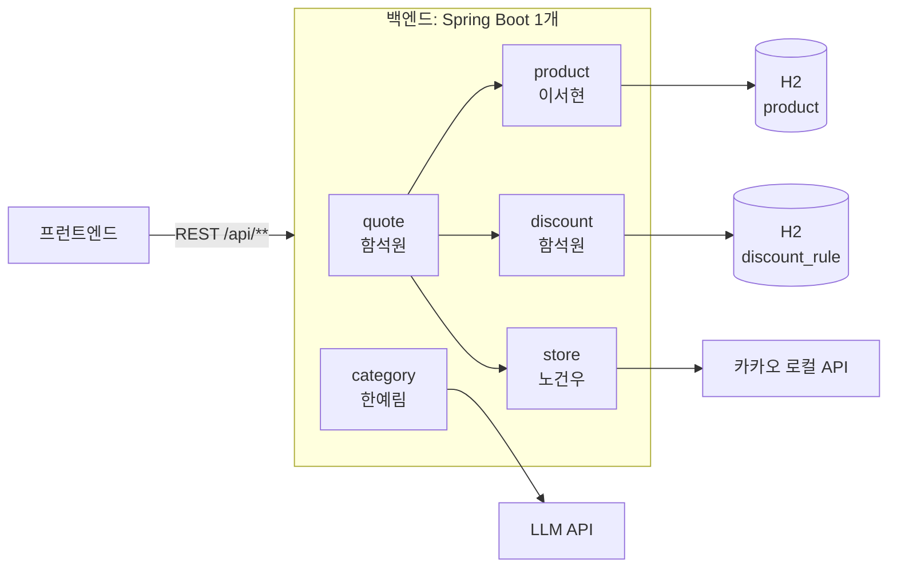
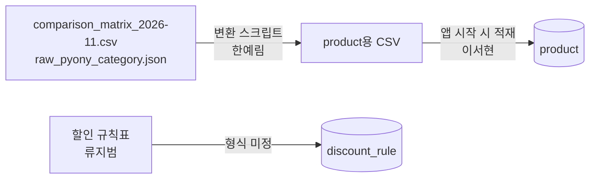

# 설계

백엔드의 모듈 경계, 모듈 간 인터페이스, `POST /api/quotes` 흐름, 데이터 적재, 외부 API를 정해요. **요구사항 · 계산 규칙 · API 계약의 원본은 요구사항명세서**예요(사본: [reference/](reference/requirements.md)). 이 문서는 그것을 코드로 옮기는 방법을 적어요. 둘이 다르면 요구사항명세서를 따르고 이 문서를 고쳐요.

## 1. 전체 구조



| 항목 | 값 |
| --- | --- |
| 형태 | 모놀리스. 애플리케이션 1개, 모듈끼리는 **메서드 호출** (수행계획서 4절) |
| 언어 · 프레임워크 | Java 17, Spring Boot 4.1.2, Spring Data JPA, Bean Validation, Lombok |
| DB | H2 파일 모드 (안). 테이블 2개: `product`, `discount_rule` ([reference/erd.md](reference/erd.md)) |
| 저장하지 않는 것 | 결제 수단(브라우저 저장), 매장(카카오 응답 저장 금지), 재고(요청 때 해시로 계산) |
| 외부 API | 카카오 로컬(매장 검색), LLM(검색어 → 상품군) |
| 실행 | `backend/`에서 `./gradlew bootRun`. 기본 포트 8080 (안) |
| 범위 밖 | 로그인 · 결제 · 실시간 가격 수집 · 실제 재고 연동 |

## 2. 모듈

모듈은 패키지로 나눠요. 패키지 구조와 이름 규칙은 [code-convention.md](code-convention.md#패키지-구조)에 있어요.

| 모듈 (패키지) | 주인 | 하는 일 | API |
| --- | --- | --- | --- |
| `common` | 이서현 | 오류 응답, CORS, 공통 설정, CSV 적재기 | — |
| `product` | 이서현 | 상품 조회, PB 표시(FR-09) | `GET /api/products` |
| `discount` | 함석원 | 할인 규칙 조회, 결제 수단 선택지 | `GET /api/wallet-options` |
| `quote` | 함석원 | 4단계 결제액 계산, 결과 목록 조립 | `POST /api/quotes` |
| `store` | 노건우 | 카카오 로컬 호출, 브랜드 판별, 거리, 재고 더미 | `GET /api/stores` |
| `category` | 한예림 | 검색어 → 상품군(키워드 사전, AI), 사전 분류(FR-08) | `GET /api/categories/resolve` |

- 다른 모듈의 Repository나 엔티티를 직접 다루지 않아요. **그 모듈의 Service(아래 인터페이스)만 불러요.**
- 모듈 사이 의존은 `quote → product · discount · store` 방향만 있어요. 반대 방향이나 순환 의존은 만들지 않아요.
- 모든 모듈은 `common`을 쓸 수 있어요. `common`은 다른 모듈을 쓰지 않아요.

## 모듈 간 인터페이스

스프린트 0 끝에 이서현이 고정해요. 이름은 아직 안이에요. **각 주인이 고정값을 돌려주는 임시 구현을 먼저 올리면** 함석원은 기다리지 않고 quotes를 조립해요.

| 인터페이스 | 입력 → 출력 | 주인 |
| --- | --- | --- |
| `ProductService.findByCategory` | `category` → `List<Product>` | 이서현 |
| `StoreService.findNearby` | `x` · `y` · `radius` → `List<Store>`. 카카오 오류는 예외 타입으로 구분 | 노건우 |
| `StockService.statusOf` | `storeId` · `productId` → `IN_STOCK` · `LOW` · `OUT` | 노건우 |
| `DiscountRuleService.findFor` | `wallet` · `brand` → `List<DiscountRule>` | 함석원 |
| `CategoryResolver.resolve` | `q` → `category` · `confidence` · `method` | 한예림 |

- 반환 타입(`Product`, `Store`, `DiscountRule`)은 엔티티가 아니라 **모듈 밖으로 내보내는 DTO**로 해요 (안). 엔티티를 바꿔도 쓰는 사람의 코드가 깨지지 않아요.
- `Store` 필드는 `GET /api/stores` 응답과 같게 해요: `storeId`, `brand`, `placeName`, `distanceM`, `x`, `y`, `roadAddress`. `walkMinutes`는 아래 7장 7번이에요.
- 카카오 오류 예외 이름: 미정(노건우). 안: `KakaoRateLimitException`(429), `KakaoApiException`(그 밖)
- 인터페이스를 바꾸려면 [스펙 변경 이슈](CONTRIBUTING.md#스펙-변경-이슈)를 열고 쓰는 사람에게 알려요.

## 3. `POST /api/quotes` 흐름 (함석원)

요청 · 응답 형식은 [reference/api-spec.md 5절](reference/api-spec.md#5-post-apiquotes)에 있어요.

```
POST /api/quotes (함석원)
 ├─ StoreService.findNearby(x, y, radius) ── 노건우 ── 카카오 로컬 API
 ├─ 브랜드별 가장 가까운 매장 1곳 (그 브랜드 매장이 없으면 그 브랜드 행은 뺀다)
 ├─ ProductService.findByCategory ────────── 이서현 ── product 테이블
 ├─ DiscountRuleService.findFor ──────────── 함석원 ── discount_rule 테이블
 ├─ 4단계 계산 × 상품 수 ────────────────── 함석원 ── 검증 예시(류지범)
 ├─ StockService.statusOf ───────────────── 노건우
 └─ 정렬 · notice · mockRule → 응답
```

### 4단계 계산

규칙 원문은 [reference/requirements.md 2절](reference/requirements.md#2-최종-결제액-계산-규칙-fr-04)이에요. 코드로 옮길 때 지킬 것만 적어요.

| 순서 | 단계 | 코드로 옮길 때 |
| --- | --- | --- |
| 1 | 행사 | N+1의 N: `ONE_PLUS_ONE` = 1, `TWO_PLUS_ONE` = 2, `THREE_PLUS_ONE` = 3. `paidQty`는 1부터 늘려 가며 조건을 만족하는 첫 값 (`qty` ≤ 10이라 반복으로 충분해요) |
| 2 | 통신사 할인 | 규칙은 1개만. `event` ≠ `NONE`이고 `stackWithEvent` = false면 `applied` = false, `reason` = "행사 상품 중복 불가" |
| 3 | 결제 할인 | 카드 · 페이 후보를 모두 계산한 뒤 할인액이 가장 큰 1개만 `applied` = true. 나머지도 `applied` = false와 이유를 담아요 |
| 4 | 적립 | `kind` = POINT 중 가장 큰 1개 → `pointAmount`. `finalPrice`에서 빼지 않아요 |

- 금액은 원 단위 정수(`int`/`long`)로 계산하고, `rate`를 곱할 때만 `BigDecimal`을 써요. `double`을 쓰지 않아요 (안).
- ⌊ ⌋(버림)은 `BigDecimal.setScale(0, RoundingMode.FLOOR)`로 해요 (안).
- `reason` 문구 목록(행사 중복 불가, 전월 실적 미충족, 최소 결제액 미만, 더 큰 할인 선택 등): 미정(함석원). 프런트와 맞춰요.
- **검증 예시(류지범 손계산)를 단위 테스트로 만들고, 모두 맞아야 완료**예요. 건수는 7장 8번이에요.

### 정렬과 표시

- 정렬: `finalPrice` 오름차순 → 같으면 `distanceM` 오름차순. `stockStatus` = `OUT` 행은 맨 아래 (안)
- `mockRule`: 적용된(`applied` = true) 규칙 중 `source`가 NULL인 것이 있으면 true (NFR-01)
- `notice`: "매장마다 취급 상품이 다를 수 있음" 고정

## 4. 데이터

테이블 정의는 [reference/erd.md](reference/erd.md)에 있어요.

### 적재 (이서현 · 한예림)



- 원천: `comparison_matrix_2026-11.csv`(콜라 · 커피 · 초콜릿, 4사 비교 404줄), `raw_pyony_category.json`(음료 · 식품 전체, 라면 포함)
- 앱이 뜰 때 CSV를 **다시 적재**해요. 그래서 H2 파일의 데이터는 언제든 지워도 돼요.
- 테이블은 `backend/src/main/resources/schema.sql`로 만들어요 (함석원). JPA는 `ddl-auto: validate`로 확인만 해요 (안).
- 원천 · 변환 결과 파일 위치: `backend/src/main/resources/data/` (안, 이서현)
- 변환 스크립트 위치와 언어: 미정(한예림)
- 할인 규칙표를 어떤 형식(CSV 등)으로 받을지: 미정(함석원 · 류지범)
- 앱이 뜨면 상품군별 4사 개수를 로그로 출력해요. 4사 각 10개 이상이어야 해요 (FR-07).

### 재고 (노건우)

저장하지 않고 요청 때 계산해요 ([reference/requirements.md 3절](reference/requirements.md#3-재고-더미-규칙-fr-10)).

```java
int n = Math.floorMod((storeId + ":" + productId).hashCode(), 10);
// 0 ~ 5 → IN_STOCK, 6 ~ 8 → LOW, 9 → OUT
```

- `String.hashCode()`는 Java 명세로 값이 정해져 있어서 다시 실행해도 같은 값이 나와요. `Math.floorMod`로 음수를 양수로 바꿔요 (안).

## 5. 외부 API

| API | 쓰는 곳 | 키 (환경 변수, 안) | 주의 |
| --- | --- | --- | --- |
| 카카오 로컬 (카테고리 검색 `CS2` = 편의점) | `store` | `KAKAO_REST_API_KEY` | **응답을 DB나 파일에 저장하지 않아요** (약관). 시연 전 호출 수 확인 |
| LLM (모델 미정, 한예림) | `category` | `AI_API_KEY` | 검색 1번에 LLM 1번. 같은 검색어는 메모리에서 재사용. 실패하면 키워드 사전으로 |

- 키는 저장소에 올리지 않고 환경 변수로 받아요. `application.properties`에는 `${KAKAO_REST_API_KEY}`처럼 이름만 적어요.
- 카카오 오류(NFR-02): 429 → `KAKAO_RATE_LIMIT`, 그 밖 → `KAKAO_ERROR`. quotes에서의 동작은 아래 7장 1번이에요.

## 6. 공통 규칙

| 항목 | 값 |
| --- | --- |
| 경로 | 모두 `/api/**` |
| 형식 | JSON, UTF-8, 필드 이름 camelCase |
| 오류 응답 | `{ "code", "message" }`. 자세한 것은 [code-convention.md](code-convention.md#오류-응답) |
| CORS | 프런트 개발 주소 허용 (주소 미정: 이서현 · 강태현) |
| 인증 | 없음 |

## 7. 아직 정하지 않은 것

정해지면 해당 절과 reference를 고치고 이 표에서 지워요. 1 ~ 6은 역할 분담 문서 8절, 7 ~ 8은 역할 분담 문서와 요구사항명세서를 대조하다가 찾은 차이예요.

| # | 내용 | 정하는 사람 |
| --- | --- | --- |
| 1 | 매장 조회 실패 시 quotes 동작이 명세 안에서 달라요. NFR-02는 "429 외 오류는 매장 없이 상품 목록만", API 표는 `POST /api/quotes`가 502. 매장 없이 준다면 `storeId` · `distanceM` · `stockStatus`를 null로 둘지도 함께 | 미정(PM2 · 백엔드 리드) |
| 2 | 정렬이 가격순 · 시간순 선택으로 바뀌었다고 했는데, 명세 2절은 아직 `finalPrice` → `distanceM`이에요. 프런트가 다시 요청하지 않고 정렬한다면 quotes는 기본 가격순만 보장하면 되는지 | 미정(PM2) |
| 3 | 원천에 상품군이 없는 상품의 `category`를 변환 때 키워드로 채울지, FR-08 결과로만 채울지 (한예림 · 이서현 경계) | 미정(백엔드 리드) |
| 4 | 제로 콜라를 `COLA`에 넣을지. 정답셋 · 키워드 사전에 영향 | 미정(PO 신해원) |
| 5 | 함석원이 계산 · DB 설계를 같이 맡아 스프린트 0이 무거워요. DB 설계가 늦어지면 이서현이 명세 4절 그대로 임시 테이블을 먼저 만들고, 설계 확정 뒤 맞춰요 (안) | 미정(백엔드 리드) |
| 6 | 1+1처럼 2개 받는 행사의 개당 가격 정렬을 추가할지. 추가하면 quotes 응답에 개당 가격 칸이 필요해요 | 미정(PO 신해원) |
| 7 | 역할 분담 문서는 `StoreService`와 FR-12에 `walkMinutes`(도보 분)를 두지만, 명세 API(`/api/stores`, `/api/quotes`)에는 `distanceM`만 있어요. 응답에 `walkMinutes`를 더할지(더하면 계산식도: 예 분당 67m), 프런트가 `distanceM`으로 계산할지 | 미정(PM2 · 노건우 · 민경완) |
| 8 | FR-04 수용 기준의 검증 예시가 명세는 5건, 역할 분담 문서는 10건이에요 | 미정(PM2 · 류지범) |
