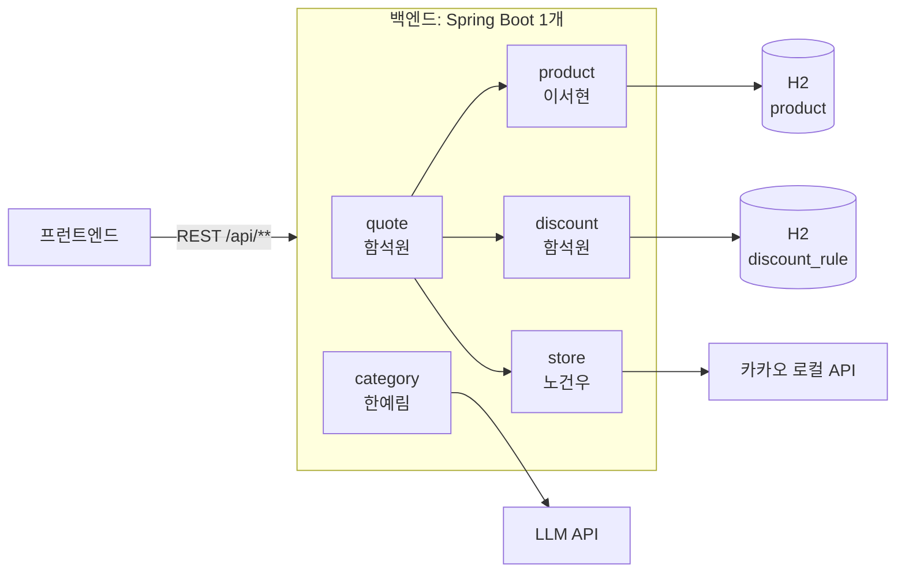
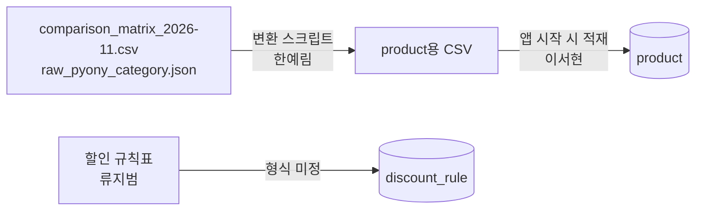

# 설계

백엔드의 모듈 경계, 모듈 간 인터페이스, `POST /api/quotes` 흐름, 데이터 적재, 외부 API를 정해요. **요구사항 · 계산 규칙 · API 계약의 원본은 요구사항명세서**예요(사본: [reference/](reference/requirements.md)). 이 문서는 그것을 코드로 옮기는 방법을 적어요. 둘이 다르면 요구사항명세서를 따르고 이 문서를 고쳐요.

## 1. 전체 구조



| 항목 | 값 |
| --- | --- |
| 형태 | 모놀리스. 애플리케이션 1개, 모듈끼리는 **메서드 호출** (수행계획서 4절) |
| 언어 · 프레임워크 | Java 17, Spring Boot 4.1.2, Spring Data JPA, Bean Validation, Lombok |
| DB | H2 파일 모드 (안). 테이블 2개: `product`, `discount_rule` ([reference/erd.md](reference/erd.md)) |
| 저장하지 않는 것 | 결제 수단(브라우저 저장), 매장(카카오 응답 저장 금지), 재고(요청 때 해시로 계산) |
| 외부 API | 카카오 로컬(매장 검색), LLM(검색어 → 상품군) |
| 실행 | `backend/`에서 `./gradlew bootRun`. 기본 포트 8080 (안) |
| 범위 밖 | 로그인 · 결제 · 실시간 가격 수집 · 실제 재고 연동 |

## 2. 모듈

모듈은 패키지로 나눠요. 패키지 구조와 이름 규칙은 [code-convention.md](code-convention.md#패키지-구조)에 있어요.

| 모듈 (패키지) | 주인 | 하는 일 | API |
| --- | --- | --- | --- |
| `common` | 이서현 | 오류 응답, CORS, 공통 설정, CSV 적재기 | — |
| `product` | 이서현 | 상품 조회, PB 표시(FR-09) | `GET /api/products` |
| `discount` | 함석원 | 할인 규칙 조회, 결제 수단 선택지 | `GET /api/wallet-options` |
| `quote` | 함석원 | 4단계 결제액 계산, 결과 목록 조립 | `POST /api/quotes` |
| `store` | 노건우 | 카카오 로컬 호출, 브랜드 판별, 거리, 재고 더미 | `GET /api/stores` |
| `category` | 한예림 | 검색어 → 상품군(키워드 사전, AI), 사전 분류(FR-08) | `GET /api/categories/resolve` |

- 다른 모듈의 Repository나 엔티티를 직접 다루지 않아요. **그 모듈의 Service(아래 인터페이스)만 불러요.**
- 모듈 사이 의존은 `quote → product · discount · store` 방향만 있어요. 반대 방향이나 순환 의존은 만들지 않아요.
- 모든 모듈은 `common`을 쓸 수 있어요. `common`은 다른 모듈을 쓰지 않아요.

## 모듈 간 인터페이스

스프린트 0 끝에 이서현이 고정해요. 이름은 아직 안이에요. **각 주인이 고정값을 돌려주는 임시 구현을 먼저 올리면** 함석원은 기다리지 않고 quotes를 조립해요.

| 인터페이스 | 입력 → 출력 | 주인 |
| --- | --- | --- |
| `ProductService.findByCategory` | `category` → `List<Product>` | 이서현 |
| `StoreService.findNearby` | `x` · `y` · `radius` → `List<Store>`. 카카오 오류는 예외 타입으로 구분 | 노건우 |
| `StockService.statusOf` | `storeId` · `productId` → `IN_STOCK` · `LOW` · `OUT` | 노건우 |
| `DiscountRuleService.findFor` | `wallet` · `brand` → `List<DiscountRule>` | 함석원 |
| `CategoryResolver.resolve` | `q` → `category` · `confidence` · `method` | 한예림 |

- 반환 타입(`Product`, `Store`, `DiscountRule`)은 엔티티가 아니라 **모듈 밖으로 내보내는 DTO**로 해요 (안). 엔티티를 바꿔도 쓰는 사람의 코드가 깨지지 않아요.
- `Store` 필드는 `GET /api/stores` 응답과 같게 해요: `storeId`, `brand`, `placeName`, `distanceM`, `x`, `y`, `roadAddress`.
- `distanceM`은 카카오가 주는 직선거리예요. 도보 거리 · 도보 시간은 백엔드가 계산하지 않아요. 프런트가 TMAP 보행자 경로 API로 받아요 (7장 7번 결정).
- 카카오 오류 예외 이름: 미정(노건우). 안: `KakaoRateLimitException`(429), `KakaoApiException`(그 밖)
- 인터페이스를 바꾸려면 [스펙 변경](CONTRIBUTING.md#스펙-변경) 순서대로 쓰는 사람에게 먼저 알려요.

## 3. `POST /api/quotes` 흐름 (함석원)

요청 · 응답 형식은 [reference/api-spec.md](reference/api-spec.md) 4-2(`API명세최종.md` 사본)에 있어요.

```
POST /api/quotes (함석원)
 ├─ CategoryResolver.resolve(q) ─────────── 한예림 ── AI → 실패 시 키워드 사전. 못 찾으면 products: []
 ├─ ProductService.findByCategory ────────── 이서현 ── product 테이블
 ├─ StoreService.findNearby(x, y, radius) ── 노건우 ── 카카오 로컬 API
 ├─ 브랜드별 가장 가까운 매장 1곳 (반경 안에 없거나 상품이 없으면 그 브랜드는 빠진다)
 ├─ DiscountRuleService.findFor ──────────── 함석원 ── discount_rule 테이블 (브랜드당 1번)
 ├─ 개당 가격 계산 × 매장 ────────────────── 함석원 ── 검증 예시(류지범)
 ├─ StockService.statusOf ───────────────── 노건우 ── 해시 예시값 (명세 5-3)
 └─ productKey로 묶기 → stores · products 정렬 → 응답
```

### 매장 조회가 실패했을 때

| 카카오 결과 | quotes 응답 |
| --- | --- |
| 429 | 429 `KAKAO_RATE_LIMIT` |
| 그 밖의 오류 · 타임아웃 | 502 `KAKAO_ERROR` |

- `StoreService.findNearby`가 던진 예외 타입으로 둘을 나눠요. 오류 응답은 `{ code, message }`예요 (명세 2절).
- 반경 안에 4사 매장이 하나도 없으면 오류가 아니라 `products: []`예요.

### 개당 가격 계산

규칙 원문은 [reference/api-spec.md](reference/api-spec.md) 5절이에요. 코드로 옮길 때 지킬 것만 적어요.

| 순서 | 단계 | 코드로 옮길 때 |
| --- | --- | --- |
| 1 | 묶음 · 행사가 | N+1이면 묶음 N+1개, 내는 개수 N개. 행사가 = 정가 × 내는 개수 |
| 2 | 통신사 할인 | 맞는 규칙 중 가장 큰 1개. 행사 상품에 중복 안 되는 규칙(`stackWithEvent` = false)이면 0원. 등급 `UNKNOWN`은 등급 무관 규칙만 |
| 3 | 결제 할인 | 카드 · 간편결제 · 할인형 멤버십 중 할인액이 가장 큰 1개. 기준 = 2단계 뒤 금액. 전월 실적은 충족한 것으로 봐요 |
| 4 | 적립 | 적립형(`kind` = POINT)은 가격에서 빼지 않아요 |
| 결과 | `unitPrice` | ⌊ (행사가 − 통신사 할인 − 결제 할인) ÷ 묶음 개수 ⌋ |

- 금액은 원 단위 정수로 계산하고, `rate`를 곱할 때만 `BigDecimal`을 써요. ⌊ ⌋(버림)은 `RoundingMode.FLOOR`예요.
- 적용 안 된 규칙의 이유(`applied` · `reason`)는 응답에 없어요. 대신 `applicableMethods`에 이 브랜드에서 쓸 수 있는 수단을 혜택 큰 순으로 담아요 (명세 5-2).
- **검증 예시(류지범 손계산)를 단위 테스트로 만들고, 모두 맞아야 완료**예요. 명세대로 5건이에요 (7장 8번 결정).

### 정렬과 표시

- `stores` 정렬: `unitPrice` 오름차순 → 같으면 `distanceM` 오름차순 → `stockStatus` = `OUT`은 맨 아래 (명세 4-2)
- `products` 정렬: `sort` = `DISTANCE`면 가장 가까운 매장의 `distanceM`, `PRICE`면 `minUnitPrice` 오름차순
- `walkMin` = ⌈ `distanceM` ÷ 67 ⌉ (직선거리 추정치). M2 실제 도보 시간은 `GET /api/routes/walking`
- 「예시 데이터」 표시는 프런트가 재고 배지 옆에 늘 붙여요 (명세 5-3). 응답에 목업 플래그(`estimated` · `dataMonth` · `mockRule`)는 없어요

## 4. 데이터

테이블 정의는 [reference/erd.md](reference/erd.md)에 있어요.

### 적재 (이서현 · 한예림)



- 원천: `comparison_matrix_2026-11.csv`(콜라 · 커피 · 초콜릿, 4사 비교 404줄), `raw_pyony_category.json`(음료 · 식품 전체, 라면 포함)
- 앱이 뜰 때 CSV를 **다시 적재**해요. 그래서 H2 파일의 데이터는 언제든 지워도 돼요.
- 테이블은 `backend/src/main/resources/schema.sql`로 만들어요 (함석원). JPA는 `ddl-auto: validate`로 확인만 해요 (안).
- 원천 · 변환 결과 파일 위치: `backend/src/main/resources/data/` (안, 이서현)
- 원천에 상품군이 없는 상품은 **변환 때 키워드로 `category`를 채워요** (7장 3번 결정). 키워드로도 못 채우면 NULL(미분류)로 두고, FR-08 사전 분류가 채워요. 제로 콜라는 `COLA` (7장 4번 결정)
- 변환 스크립트 위치와 언어: 미정(한예림)
- 할인 규칙표를 어떤 형식(CSV 등)으로 받을지: 미정(함석원 · 류지범)
- 앱이 뜨면 상품군별 4사 개수를 로그로 출력해요. 4사 각 10개 이상이어야 해요 (FR-07).

### 재고 (노건우)

저장하지 않고 요청 때 계산해요 ([reference/requirements.md 3절](reference/requirements.md#3-재고-더미-규칙-fr-10)).

```java
int n = Math.floorMod((storeId + ":" + productId).hashCode(), 10);
// 0 ~ 5 → IN_STOCK, 6 ~ 8 → LOW, 9 → OUT
```

- `String.hashCode()`는 Java 명세로 값이 정해져 있어서 다시 실행해도 같은 값이 나와요. `Math.floorMod`로 음수를 양수로 바꿔요 (안).

## 5. 외부 API

| API | 쓰는 곳 | 키 (환경 변수, 안) | 주의 |
| --- | --- | --- | --- |
| 카카오 로컬 (카테고리 검색 `CS2` = 편의점) | `store` | `KAKAO_REST_API_KEY` | **응답을 DB나 파일에 저장하지 않아요** (약관). 시연 전 호출 수 확인 |
| LLM (모델 미정, 한예림) | `category` | `AI_API_KEY` | 검색 1번에 LLM 1번. 같은 검색어는 메모리에서 재사용. 실패하면 키워드 사전으로 |

- **TMAP 보행자 경로 API(도보 거리 · 시간)는 백엔드가 쓰지 않아요.** 프런트가 매장 좌표로 직접 불러요. 백엔드에 TMAP 키와 도보 관련 API를 두지 않아요 (7장 7번 결정).
- 키는 저장소에 올리지 않고 환경 변수로 받아요. `application.properties`에는 `${KAKAO_REST_API_KEY}`처럼 이름만 적어요.
- 카카오 오류(NFR-02): 429 → `KAKAO_RATE_LIMIT`, 그 밖 → `KAKAO_ERROR`. quotes에서의 동작은 [3장](#매장-조회가-실패했을-때-7장-1번-결정)에 있어요.

## 6. 공통 규칙

| 항목 | 값 |
| --- | --- |
| 경로 | 모두 `/api/**` |
| 형식 | JSON, UTF-8, 필드 이름 camelCase |
| 오류 응답 | `{ "code", "message" }`. 자세한 것은 [code-convention.md](code-convention.md#오류-응답) |
| CORS | 프런트 개발 주소 허용 (주소 미정: 이서현 · 강태현) |
| 인증 | 없음 |

## 7. 아직 정하지 않은 것

정해지면 해당 절과 reference를 고치고 아래 "정한 것"으로 옮겨요. 번호는 처음 정리할 때의 번호를 그대로 써요. 1 ~ 6은 역할 분담 문서 8절, 7 ~ 8은 역할 분담 문서와 요구사항명세서를 대조하다가 찾은 차이예요.

| # | 내용 | 정하는 사람 |
| --- | --- | --- |
| 5 | 함석원이 계산 · DB 설계를 같이 맡아 스프린트 0이 무거워요. DB 설계가 늦어지면 이서현이 명세 4절 그대로 임시 테이블을 먼저 만들고, 설계 확정 뒤 맞춰요 (안) | 미정(백엔드 리드) |

### 정한 것

요구사항명세서 원본에도 반영해야 해요 (PM2 민경완).

| # | 결정 | 반영한 곳 |
| --- | --- | --- |
| 1 | ~~매장 조회 실패 시 200 · 매장 칸 null~~ → **`API명세최종.md`로 대체** (2026-11-10): 429 `KAKAO_RATE_LIMIT`, 그 밖 502 `KAKAO_ERROR` | 이 문서 3장 |
| 2 | ~~quotes 정렬 `finalPrice` → `distanceM`~~ → **`API명세최종.md`로 대체** (2026-11-10): `stores`는 `unitPrice` → `distanceM` → `OUT` 맨 아래, `products`는 `sort`(`DISTANCE` · `PRICE`) | 이 문서 3장, [api-spec.md](reference/api-spec.md) 4-2 |
| 3 | 원천에 상품군이 없는 상품의 `category`는 **변환 때 키워드로 채워요** (한예림 변환 스크립트). FR-08은 키워드로도 못 채운 것(NULL)만 다뤄요 | 이 문서 4장 |
| 4 | 제로 콜라는 **`COLA`에 넣어요** | [erd.md 3-1](reference/erd.md#3-1-상품-product) |
| 6 | ~~개당 가격 정렬은 추가하지 않음 (`finalPrice` 기준)~~ → **`API명세최종.md`로 대체** (2026-11-10): 개당 가격 `unitPrice` · `minUnitPrice` 기준 | 이 문서 3장 |
| 7 | ~~`walkMinutes`를 만들지 않음~~ → **`API명세최종.md`로 대체** (2026-11-10): 목록은 `walkMin` = ⌈`distanceM` ÷ 67⌉ 추정치, M2 실제 도보 경로는 `GET /api/routes/walking`(노건우) | 이 문서 3장, [api-spec.md](reference/api-spec.md) 4-2 · 4-4 |
| 9 | 옛 요구사항명세서 5절의 `applied` · `reason` · `finalPrice` 정렬 · `pointAmount` · `notice` · `mockRule` · `estimated` · `dataMonth`는 **폐기**. `API명세최종.md`대로 구현해요 (2026-11-10) | 이 문서 3장, [roles.md](roles.md), [api-spec.md](reference/api-spec.md) |
| 8 | FR-04 검증 예시는 **명세대로 5건** | 이 문서 3장, [roles.md](roles.md) |
