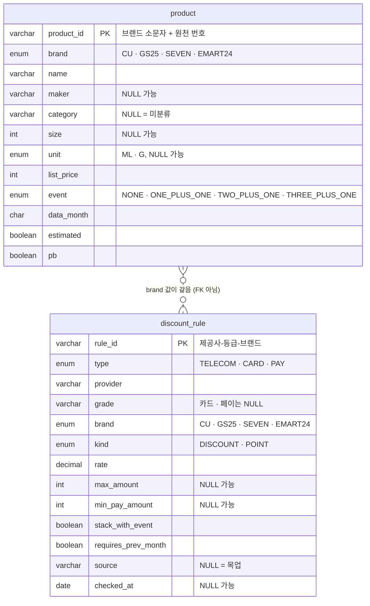

> **요구사항명세서 4절 기반 · 초안.** 칼럼 정의는 요구사항명세서 4절을 옮겼어요. DB 설계(ERD, `schema.sql`, 인덱스, H2 호환)는 함석원이 이 문서를 바탕으로 확정해요. 칼럼을 바꾸려면 요구사항명세서를 먼저 고치고, 스키마 변경 PR은 이서현이 리뷰해요.

# ERD · 테이블 명세

## 1. 개요

| 항목 | 내용 |
| --- | --- |
| 대상 | 테이블 2개: `product`, `discount_rule` (수행계획서 4절) |
| DB | H2 파일 모드 (안) |
| 스키마 원천 | `backend/src/main/resources/schema.sql` (안, 함석원). JPA는 `ddl-auto: validate`로 확인만 해요 (안) |
| 데이터 | 앱이 뜰 때 CSV로 다시 적재해요 ([design.md](../design.md#4-데이터)) |
| 이름 | 테이블과 칼럼은 소문자 스네이크 표기, 테이블은 단수형. API에서는 camelCase |

### 저장하지 않는 것

| 대상 | 이유 | 관련 FR |
| --- | --- | --- |
| 결제 수단 | 로그인 없이 브라우저에 저장 | FR-01 |
| 매장 | 카카오 응답 저장 금지 (약관). 요청 때마다 조회 | FR-03 |
| 재고 | 요청 때 해시로 계산 ([requirements.md 3절](requirements.md#3-재고-더미-규칙-fr-10)) | FR-10 |

## 2. ERD

두 테이블 사이에 외래 키는 없어요. `brand` 값으로만 이어져요. 할인 규칙은 브랜드 단위로 걸리고, 상품 하나하나에 걸리지 않아요.

## 3. 테이블 명세

### 3-1. 상품 `product`

| 칸 | 타입 | NULL | 예 | 설명 |
| --- | --- | --- | --- | --- |
| `product_id` | varchar(40) PK | N | `cu-45315` | 브랜드 소문자 + 원천 번호 |
| `brand` | enum | N | `GS25` | `CU` · `GS25` · `SEVEN` · `EMART24` |
| `name` | varchar(100) | N | `펩시콜라600ml` | 원천 표기 그대로 |
| `maker` | varchar(40) | Y | `롯데` | |
| `category` | varchar(30) | Y | `COLA` | 상품군. NULL = 미분류 (FR-08이 갱신) |
| `size` | int | Y | `600` | |
| `unit` | enum | Y | `ML` | `ML` · `G` |
| `list_price` | int | N | `2500` | 정가(원) |
| `event` | enum | N | `ONE_PLUS_ONE` | `NONE` · `ONE_PLUS_ONE` · `TWO_PLUS_ONE` · `THREE_PLUS_ONE` |
| `data_month` | char(7) | N | `2026-11` | 데이터 기준 월 |
| `estimated` | boolean | N | `false` | 다른 브랜드 정가로 채운 추정 값이면 true |
| `pb` | boolean | N | `false` | 한 브랜드 전용 상품 |

상품군 목록(안): `COLA` · `CIDER` · `COFFEE` · `RAMEN_CUP` · `RAMEN_BAG` · `CHOCOLATE`. 제로 콜라를 `COLA`에 넣을지는 미정(PO 신해원)이에요.

### 3-2. 할인 규칙 `discount_rule`

| 칸 | 타입 | NULL | 예 | 설명 |
| --- | --- | --- | --- | --- |
| `rule_id` | varchar(40) PK | N | `kt-vip-gs25` | 제공사-등급-브랜드 |
| `type` | enum | N | `TELECOM` | `TELECOM` · `CARD` · `PAY` |
| `provider` | varchar(30) | N | `KT` | 통신사 · 카드 · 페이 이름 |
| `grade` | varchar(20) | Y | `VIP` | 통신사 등급. 카드 · 페이는 NULL |
| `brand` | enum | N | `GS25` | 적용 브랜드 |
| `kind` | enum | N | `DISCOUNT` | `DISCOUNT`(할인) · `POINT`(적립) |
| `rate` | decimal(4,3) | N | `0.100` | |
| `max_amount` | int | Y | `null` | 1회 최대 할인 · 적립액 |
| `min_pay_amount` | int | Y | `null` | 최소 결제액 |
| `stack_with_event` | boolean | N | `false` | 행사 상품에 중복되나 |
| `requires_prev_month` | boolean | N | `false` | 전월 실적 조건 |
| `source` | varchar(300) | Y | 공지 URL | NULL이면 목업 → 응답의 `mockRule` |
| `checked_at` | date | Y | `2026-11-09` | 공지 확인 날짜 |

## 4. 설계에서 챙길 것 (함석원, 안)

| 항목 | 안 | 확인 |
| --- | --- | --- |
| enum 저장 방식 | DB에는 `varchar` + JPA `@Enumerated(EnumType.STRING)`. H2의 `ENUM` 타입을 쓰지 않아 값을 늘리기 쉬워요 | 미정(함석원) |
| `rule_id` 카드 · 페이 형식 | `grade`가 NULL이라 `제공사-브랜드`가 돼요. 예) `shinhan-gs25`. 원천 이름(한글)을 영문 소문자로 바꾸는 규칙 필요 | 미정(함석원 · 류지범) |
| 인덱스 | `product(category)`, `discount_rule(brand)` | |
| `category` 칸 | 상품군 목록이 늘 수 있어 enum 대신 varchar(30) (명세 그대로) | |
| 금액 칸 | `list_price` · `max_amount` · `min_pay_amount`는 원 단위 정수 | |
| `rate` | Java에서는 `BigDecimal`로 받아요 | |
| H2 호환 | `schema.sql`을 H2에서 실행해 확인. 예약어(`type`, `size`, `name`, `event`, `source` 등) 칼럼 이름이 H2에서 문제없는지 확인 | 미정(함석원) |

## 5. 칼럼 ↔ FR · API 대조

빠진 칸이 없는지 확인하는 표예요.

| 쓰는 곳 | `product` 칸 | `discount_rule` 칸 |
| --- | --- | --- |
| FR-04 계산 | `list_price`, `event`, `brand` | `type`, `provider`, `grade`, `brand`, `kind`, `rate`, `max_amount`, `min_pay_amount`, `stack_with_event`, `requires_prev_month` |
| FR-05 결과 목록 (`POST /api/quotes`) | `product_id`, `name`, `size`, `unit`, `pb`, `list_price`, `event`, `data_month`, `estimated` | `rule_id`, `type`, `source` (`mockRule`) |
| FR-07 상품 데이터 | 모든 칸 | |
| FR-08 사전 분류 | `category` 갱신 | |
| FR-09 PB 표시 | `pb` | |
| FR-11 결제 수단 선택지 (`GET /api/wallet-options`) | | `type`, `provider`, `grade` |
| NFR-01 목업 표시 | `estimated`, `data_month` | `source` |

- 응답의 할인 내역 `label`(예: `KT VIP`)은 `provider` + `grade`로 만들어요 (안). 따로 칸을 두지 않아요.
