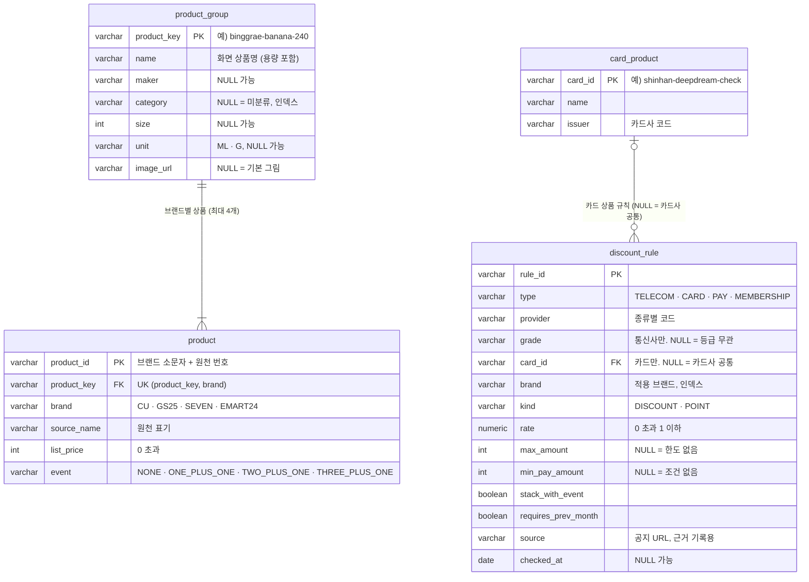

> **DB 설계 초안 v1.3 (함석원).** **REST API 명세 v1.1(B 매대 가격표 화면 기준, 2026-11-09)만 기준**으로 설계했어요. 요구사항명세서 4절의 칸을 바탕으로 했고, 데이터 수집 · 가공 가이드의 DB 안(매장 · 재고 저장)은 쓰지 않아요 (결정 2026-11-09). DDL은 [`backend/src/main/resources/schema.sql`](../../backend/src/main/resources/schema.sql)이에요. 스키마 변경 PR은 이서현이 리뷰해요. `(안)` = 제안값이에요.

# ERD · 테이블 명세

## 1. 개요

| 항목 | 내용 |
| --- | --- |
| 대상 | 테이블 4개: `product_group`, `product`, `card_product`, `discount_rule` |
| DB | H2 2.4.240 (Spring Boot 4.1.2 기본), 파일 모드 (안) |
| 스키마 원천 | `backend/src/main/resources/schema.sql`. JPA는 `ddl-auto: validate`로 확인만 해요 (안) |
| 데이터 | 앱이 뜰 때마다 테이블을 지우고 다시 만든 뒤, CSV로 다시 적재해요. 원천: `comparison_matrix_2026-11.csv` · `raw_pyony_category.json`(상품), 할인 규칙표(함석원) |
| 이름 | 테이블과 칼럼은 소문자 스네이크 표기, 테이블은 단수형. API에서는 camelCase |
| 제약 이름 | `pk_<테이블>`, `fk_<테이블>_<대상>`, `uk_<테이블>_<무엇>`, `ck_<테이블>_<칸>`, `ix_<테이블>_<칸>` |

### 저장하지 않는 것

| 대상 | 이유 | API |
| --- | --- | --- |
| 할인 수단 (내 wallet) | 로그인 없이 브라우저(localStorage)에 저장 | 요청 본문 `wallet` |
| 매장 | 카카오 로컬 응답 저장 금지 (약관). 요청 때마다 조회 | `stores[]`, `GET /api/stores` |
| 재고 | `storeId + ":" + productKey` 해시로 요청 때 계산 (API 5-3). **지금은 더미 데이터로 둬요.** 실제 재고는 데이터 수집 문서를 참고해 추후 논의해요 (결정 2026-11-09) | `stockStatus` |
| 도보 경로 | TMAP 보행자 경로 API 응답. 짧은 메모리 캐시만 (안) | `GET /api/routes/walking` |
| 도보 분 | ⌈`distanceM` ÷ 67⌉ 계산 | `walkMin` |
| 코드값 이름 | 통신사 · 카드사 · 간편결제 · 멤버십 · 브랜드의 화면 이름(예: `LGU` → "LG U+", `GS25` 멤버십 → "GS&POINT")은 Java enum에 둬요 (안) | `wallet-options`의 `name` |

### 요구사항명세서 4절(테이블 2개)에서 바뀐 점

| # | 바뀐 점 | 이유 (API v1.1) |
| --- | --- | --- |
| 1 | 상품을 **`product_group`(상품 묶음)과 `product`(브랜드별 상품)로 나눔** | 응답이 `products[]`(같은 상품) 아래 `stores[]`(브랜드별 가격)예요. 상품명 · 이미지 · 상품군은 묶음 단위, 정가 · 행사는 브랜드 단위예요 |
| 2 | `product_group.image_url` 추가 | P2 상품 이미지 (`imageUrl`, NULL 가능) |
| 3 | `card_product` 테이블 추가 | `wallet-options`의 `cards[]`(`cardId` · `name` · `issuer`) |
| 4 | `discount_rule.type`에 `MEMBERSHIP` 추가 | 편의점 멤버십 수단 |
| 5 | `discount_rule.card_id` 추가 (NULL = 카드사 공통) | 목록에서 고른 카드는 카드 상품 규칙, 직접 입력한 카드는 카드사 공통 규칙 |
| 6 | 통신사 규칙의 `grade` NULL 허용 (등급 무관) | 사용자 등급 `UNKNOWN`은 등급 무관 규칙만 맞아요 |
| 7 | `provider`를 코드값으로 (`SKT`, `SHINHAN`, `KAKAOPAY`, `CU` 등) | API 3절 코드값과 같게 |
| 8 | `pb` · `data_month` · `estimated` 제거 | PB는 조회할 때 계산해요. 화면 · API에 기준 월 · 추정 · 목업 할인 표시가 없어요 (결정 2026-11-09) |

## 2. ERD



- `product`와 `discount_rule` 사이에는 외래 키가 없어요. 할인 규칙은 **브랜드 단위**로 걸리고, `brand` 값으로만 이어져요.

## 3. 테이블 명세

### 3-1. 상품 묶음 `product_group`

4사의 **같은 상품** 하나예요. 응답 `products[]` 한 줄이 이 테이블 한 행이에요.

| 칸 | 타입 | NULL | 예 | API 필드 | 규칙 |
| --- | --- | --- | --- | --- | --- |
| `product_key` | VARCHAR(60) | N | `binggrae-banana-240` | `productKey` | PK. 영문 소문자 · 숫자 · `-`만 |
| `name` | VARCHAR(100) | N | `빙그레 바나나맛우유 240ml` | `name` | 화면 표시용 정확한 상품명 |
| `maker` | VARCHAR(40) | Y | `빙그레` | — | |
| `category` | VARCHAR(30) | Y | `MILK` | (검색에 사용) | 인덱스. NULL = 미분류 |
| `size` | INT | Y | `240` | — | 0 초과. `unit`과 함께 있거나 함께 NULL |
| `unit` | VARCHAR(5) | Y | `ML` | — | `ML` · `G` |
| `image_url` | VARCHAR(300) | Y | `https://…/banana.png` | `imageUrl` | NULL = 프론트 기본 그림 |

**상품군(`category`)**: `COLA` · `CIDER` · `COFFEE` · `MILK` · `RAMEN_CUP` · `RAMEN_BAG` · `CHOCOLATE` (요구사항명세서 4-1 + `MILK`, 결정 2026-11-09)
- 값 검사(CHECK)를 하지 않아서 상품군이 늘어도 스키마는 그대로예요.
- 제로 콜라는 `COLA` (결정 2026-11-09)
- 원천에 상품군이 없는 상품은 변환 때 키워드로 채우고, 못 채우면 NULL(미분류)이에요 (결정 2026-11-09)

### 3-2. 브랜드별 상품 `product`

한 브랜드에서 파는 그 상품의 정가 · 행사예요. 응답 `stores[]`의 가격 계산 근거예요. 같은 브랜드는 전 매장 같은 가격으로 봐요.

| 칸 | 타입 | NULL | 예 | API 필드 | 규칙 |
| --- | --- | --- | --- | --- | --- |
| `product_id` | VARCHAR(40) | N | `cu-45315` | — (내부 id) | PK. `LOWER(brand) || '-'`로 시작 |
| `product_key` | VARCHAR(60) | N | `binggrae-banana-240` | — | FK → `product_group` |
| `brand` | VARCHAR(10) | N | `CU` | `stores[].brand` | `CU` · `GS25` · `SEVEN` · `EMART24` |
| `source_name` | VARCHAR(100) | N | `바나나맛우유240ml` | — | 원천 표기 그대로 (확인용) |
| `list_price` | INT | N | `1500` | `listPrice` | 0 초과 |
| `event` | VARCHAR(20) | N | `TWO_PLUS_ONE` | `stores[].event` | API 3절 `Event` 4값 |

- **UNIQUE `(product_key, brand)`**: 한 묶음에 브랜드마다 상품은 1개예요. 그래서 매장(브랜드)마다 가격을 하나로 정할 수 있어요.

### 3-3. 카드 상품 `card_product`

`wallet-options`의 `cards[]`(D3 카드 검색 목록)예요.

| 칸 | 타입 | NULL | 예 | API 필드 | 규칙 |
| --- | --- | --- | --- | --- | --- |
| `card_id` | VARCHAR(40) | N | `shinhan-deepdream-check` | `cardId` | PK. 영문 소문자 · 숫자 · `-`만 |
| `name` | VARCHAR(60) | N | `신한카드 Deep Dream 체크` | `name` | |
| `issuer` | VARCHAR(10) | N | `SHINHAN` | `issuer` | API 3절 `CardIssuer` 9값 |

### 3-4. 할인 규칙 `discount_rule`

| 칸 | 타입 | NULL | 예 | 설명 | 규칙 |
| --- | --- | --- | --- | --- | --- |
| `rule_id` | VARCHAR(80) | N | `skt-vip-cu` | [4절](#4-rule_id-규칙-안) | PK |
| `type` | VARCHAR(10) | N | `TELECOM` | API `MethodType` | `TELECOM` · `CARD` · `PAY` · `MEMBERSHIP` |
| `provider` | VARCHAR(15) | N | `SKT` | 종류별 코드 | 아래 표 |
| `grade` | VARCHAR(10) | Y | `VIP` | 통신사 등급. NULL = 등급 무관 | 통신사만, `VIP` · `NORMAL` |
| `card_id` | VARCHAR(40) | Y | `shinhan-deepdream-check` | 카드 상품. NULL = 카드사 공통 | 카드만. FK → `card_product` |
| `brand` | VARCHAR(10) | N | `CU` | 적용 브랜드 | 인덱스 |
| `kind` | VARCHAR(10) | N | `DISCOUNT` | `DISCOUNT`(할인) · `POINT`(적립) | |
| `rate` | NUMERIC(4,3) | N | `0.100` | | 0 초과 1 이하 |
| `max_amount` | INT | Y | `null` | 1회 최대 할인 · 적립액 | 0 초과 |
| `min_pay_amount` | INT | Y | `null` | 최소 결제액 | 0 이상 |
| `stack_with_event` | BOOLEAN | N | `false` | 행사 상품에 중복되나 | |
| `requires_prev_month` | BOOLEAN | N | `false` | 전월 실적 조건 | API 5-1은 충족한 것으로 보고 계산. 규칙표 값은 그대로 저장 |
| `source` | VARCHAR(300) | Y | 공지 URL | 규칙 근거 기록용. API 응답에는 없어요 | |
| `checked_at` | DATE | Y | `2026-11-09` | 공지 확인 날짜 | |

**종류별 `provider` · `grade` · `card_id` (CHECK로 강제)**

| `type` | `provider` | `grade` | `card_id` |
| --- | --- | --- | --- |
| `TELECOM` | `SKT` · `KT` · `LGU` | `VIP` · `NORMAL` · NULL(등급 무관) | NULL |
| `CARD` | 카드사 코드 9개 | NULL | 카드 상품 id 또는 NULL(카드사 공통) |
| `PAY` | `KAKAOPAY` · `NAVERPAY` · `TOSSPAY` · `SAMSUNGWALLET` | NULL | NULL |
| `MEMBERSHIP` | **`brand`와 같은 값** (자기 브랜드에서만 맞음) | NULL | NULL |

- **UNIQUE `(type, provider, grade, card_id, brand, kind)` NULLS NOT DISTINCT**: 같은 규칙은 1개예요. NULL(등급 무관 · 카드사 공통)끼리도 중복을 막아요 (H2에서 확인함).

**규칙 찾는 법 (API 5-1, 결정 2026-11-09)**

| 사용자 수단 | 맞는 규칙 (`brand` = 매장 브랜드) |
| --- | --- |
| 통신사 `SKT` · `VIP` | (`grade='VIP'` 또는 `grade IS NULL`) → 둘 다 후보, 할인액이 큰 1개 |
| 통신사 `SKT` · `NORMAL` | (`grade='NORMAL'` 또는 `grade IS NULL`) → 둘 다 후보, 할인액이 큰 1개 |
| 통신사 `SKT` · `UNKNOWN` | `grade IS NULL`만 |
| 카드 (목록에서 고름) | `card_id=<cardId>` 또는 (`provider=<issuer>`, `card_id IS NULL`) → 둘 다 후보 |
| 카드 (직접 입력) | `provider=<issuer>`, `card_id IS NULL` |
| 간편결제 | `type=PAY`, `provider=<코드>` |
| 편의점 멤버십 | `type=MEMBERSHIP`, `provider=<브랜드>` (= 매장 브랜드일 때만) |

- 카드 · 간편결제 · 할인형 멤버십 후보는 결제 할인 단계에서 함께 비교해 할인액이 큰 1개를 써요. `applicableMethods`도 같은 기준이에요. 하나라도 맞으면 그 수단을 넣어요.

## 4. `rule_id` 규칙 (안)

영문 소문자와 `-`로 써요. 할인 규칙표의 행과 1:1이에요.

| 경우 | 형식 | 예 |
| --- | --- | --- |
| 통신사 등급 규칙 | `<통신사>-<등급>-<브랜드>` | `skt-vip-cu`, `kt-normal-gs25` |
| 통신사 등급 무관 | `<통신사>-<브랜드>` | `lgu-seven` |
| 카드 상품 규칙 | `<card_id>-<브랜드>` | `shinhan-deepdream-check-cu` |
| 카드사 공통 | `<카드사>-<브랜드>` | `shinhan-cu` |
| 간편결제 | `<간편결제>-<브랜드>` | `kakaopay-gs25` |
| 편의점 멤버십 | `<브랜드>-membership` | `cu-membership` |
| 같은 수단 · 브랜드에 적립 규칙이 따로 있음 | 뒤에 `-point` | `shinhan-cu-point` |

## 5. API v1.1 ↔ DB 대조

### 5-1. `GET /api/wallet-options`

| 응답 | 출처 |
| --- | --- |
| `telecoms[]` | `discount_rule`의 TELECOM `provider` + enum 이름. `grades`는 항상 `VIP` · `NORMAL` · `UNKNOWN` |
| `cards[]` | `card_product` (안: 규칙이 있는 카드만) |
| `cardIssuers[]` · `pays[]` · `memberships[]` | `discount_rule.provider` + enum 이름 |

### 5-2. `POST /api/quotes`

| 응답 | 출처 |
| --- | --- |
| `products[].productKey` · `name` · `imageUrl` | `product_group` |
| `products[].event` · `listPrice` | **개당 가격(`unitPrice`)이 가장 싼 매장**의 `product.event` · `list_price` (결정 2026-11-09). 개당 가격이 같으면 더 가까운 매장 |
| `products[].minUnitPrice` · `storeCount` | 계산 |
| `stores[].storeId` · `placeName` · `x` · `y` | 카카오 로컬 (`id` · `place_name` · `x` · `y`) |
| `stores[].distanceM` · `walkMin` | 카카오 거리, ⌈`distanceM` ÷ 67⌉ |
| `stores[].event` · `eventLabel` | `product.event`. `eventLabel`은 `event`에서 만들어요 (예: `TWO_PLUS_ONE` → "2+1 행사") |
| `stores[].unitPrice` | `product.list_price` · `event` + `discount_rule` (API 5-1) |
| `stores[].applicableMethods` | `discount_rule` (API 5-2) |
| `stores[].stockStatus` | 해시 계산 (API 5-3) |

### 5-3. `GET /api/stores` · `GET /api/routes/walking`

DB를 쓰지 않아요. 매장은 카카오 로컬, 도보 경로는 TMAP 보행자 경로 API(결정 2026-11-09)예요.

### quotes가 DB를 읽는 순서

```
POST /api/quotes { q, x, y, radius, sort, wallet }
 1. q → category                          (CategoryResolver, 한예림)
 2. product_group WHERE category = ?      (ix_product_group_category)
 3. 카카오 로컬 → 브랜드별 가장 가까운 매장
 4. product WHERE product_key IN (...) AND brand IN (매장 브랜드)
 5. discount_rule WHERE brand IN (...)    (ix_discount_rule_brand) → 3-4 표대로 wallet과 맞추기
 6. unitPrice · applicableMethods · stockStatus 계산
```

데이터가 수백 건이라 쿼리 몇 번이면 충분해요. 규칙 테이블은 시작할 때 메모리에 올려 둬도 돼요 (안).

## 6. 설계 결정 · 코드 연결

| 항목 | 결정 (안) | 이유 |
| --- | --- | --- |
| 상품 둘로 나누기 | `product_group` 1 : N `product` (FK) | 이름 · 이미지 · 상품군을 한 곳에 둬서 브랜드마다 달라지지 않게 해요 |
| 다시 만들기 | `schema.sql` 맨 앞에서 자식 테이블부터 `DROP TABLE IF EXISTS` | 시작할 때마다 CSV로 다시 적재해요 |
| 적재 순서 | `product_group` → `product`, `card_product` → `discount_rule` | FK 순서 |
| enum 칼럼 | `VARCHAR` + `CHECK`. JPA는 `@Enumerated(EnumType.STRING)` | H2 `ENUM` 타입은 쓰지 않아요 |
| 금액 · 비율 | `INT`(원), `rate`는 `NUMERIC(4,3)` → `BigDecimal` | `double`로 받지 않아요 |
| PB | 저장하지 않음 | 한 묶음의 `product` 행이 1개면 PB (FR-09, 선택) |
| 인덱스 | `ix_product_group_category`, `ix_discount_rule_brand`. `product(product_key)`는 UNIQUE가 대신해요 | |
| 예약어 | 문제없음 | `type` · `size` · `name` · `event` · `source` · `kind` · `rate`를 칼럼 이름으로 써도 H2 2.4.240에서 실행돼요 (확인함) |
| `schema.sql` 실행 | 파일 모드(`jdbc:h2:file:...`)에서는 `spring.sql.init.mode=always`가 필요해요 (이서현) | 테스트(메모리 H2)에서는 자동 실행 확인 |
| `ddl-auto` | `validate` (또는 `none`) | `create-drop`이면 Hibernate가 엔티티로 테이블을 다시 만들어 `schema.sql`의 제약이 무시돼요 |
| enum 매핑 확인 | Hibernate가 H2 `ENUM` 타입을 기대해 `validate`가 실패하면 `@JdbcTypeCode(SqlTypes.VARCHAR)` | 엔티티 만들 때 확인 필요 |

## 7. 검증 기록

`schema.sql`을 H2 2.4.240에서 실행해서 확인했어요 (2026-11-09).

| 확인 | 결과 |
| --- | --- |
| 정상 행 넣기: 묶음 2(우유 · 커피) · 상품 3 · 카드 1 · 규칙 6 (통신사 등급 · 등급 무관 · 카드 상품 · 카드사 공통 · 간편결제 · 멤버십 적립) | 성공. `MILK` → 묶음 → 브랜드별 상품 조인 조회도 확인 |
| 같은 묶음 · 같은 브랜드 상품 2개 | `uk_product_key_brand`로 막힘 |
| 없는 `product_key`를 가리키는 상품 | `fk_product_group`으로 막힘 |
| API에 없는 행사 값 (`OTHER`) | `ck_product_event`로 막힘 |
| `product_key`에 대문자 · 공백 | `ck_product_group_key`로 막힘 |
| 멤버십 `provider`가 적용 브랜드와 다름 | `ck_discount_rule_provider`로 막힘 |
| 통신사 `grade` = `UNKNOWN` | `ck_discount_rule_grade`로 막힘 |
| 같은 카드사 공통 규칙 2개 | `uk_discount_rule`로 막힘 (NULL 포함) |
| 없는 카드 상품을 가리키는 규칙 | `fk_discount_rule_card`로 막힘 |
| 스키마 다시 실행 (재시작 상황) | 테이블이 비워진 채 다시 만들어짐 |
| `./gradlew test` (앱 시작 시 `schema.sql` 실행) | 통과 |

## 8. 남은 결정

| # | 내용 | 정하는 사람 |
| --- | --- | --- |
| 1 | `productKey` 만드는 규칙(원천 `comparison_matrix`의 같은 상품 줄 = 같은 키 (안))과 상품 이미지(`image_url`) 출처 | 미정(한예림) |
| 2 | 원천 데이터에 우유(`MILK`) 상품이 있는지. 없으면 v1.1 대표 검색어 "우유"가 빈 결과예요 | 미정(한예림) |
| 3 | 할인 규칙표 · 카드 상품 CSV 형식: [discount-rule-csv.md](discount-rule-csv.md) 초안. "1,000원당 100원" · 정액 할인을 칸으로 표현할지 | 함석원 |
| 4 | H2 파일 경로, `spring.sql.init.mode=always`, `ddl-auto=validate` 설정 | 미정(이서현) |
